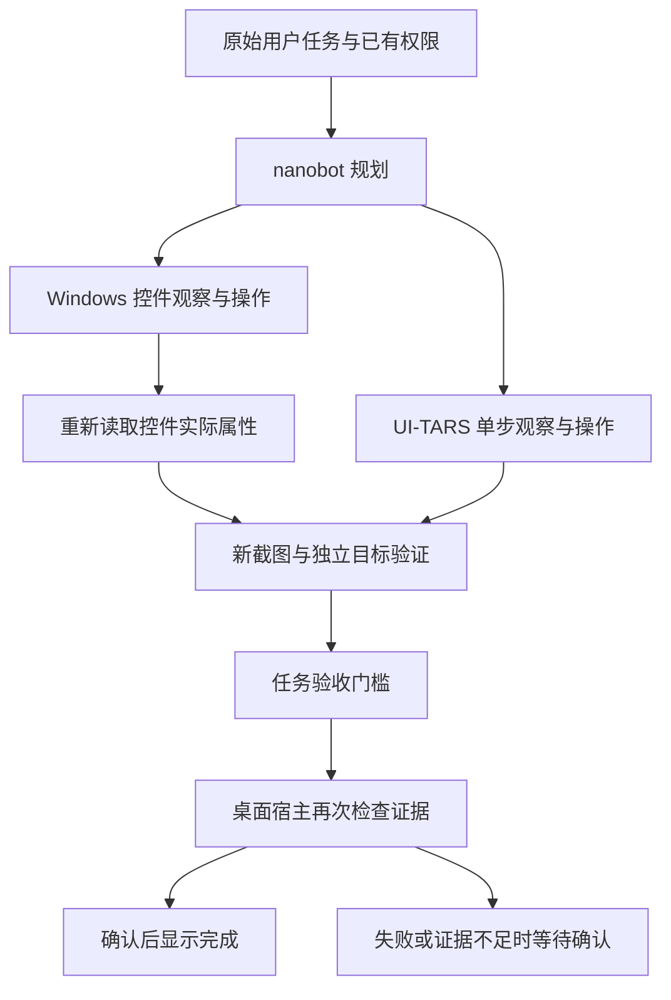

# 电脑操作与结果确认

本次保留 PySide6、nanobot 和 UI-TARS 执行链，增加 Windows 原生控件操作和独立目标验收。没有将多个完整 Agent 同时安装进桌宠，没有修改用户的模型配置、密钥、Clash 或开机设置。

## 使用时的变化

- 普通按钮、复选框和输入框可以通过 Windows 控件结构操作；画布和没有可访问性结构的视频界面仍使用视觉操作。
- 勾选先读当前状态，已经勾选时不会再点一次取消。每次修改后重新读取实际属性。
- `finished()` 只表示动作循环结束。程序随后重新截图，单独检查原始任务的目标身份和最终状态。
- 检查失败、证据不足、截图失败、返回格式错误和验证服务不可用均不能显示完成。点赞、提交、发送等动作不会为了取得成功标记而自动重放。
- 打开应用不能证明后续点赞完成；单个控件属性正确也不证明整个任务完成。
- 整项任务仍不设时长或步数上限，停止按钮保留。单次验证有 30 秒网络时限，控件辅助进程也有单次时限，防止卡死应用拖住任务。

源码更新后从通知区退出旧桌宠再启动；仅关闭聊天窗口会保留原进程。手机沿用电脑执行链，本次状态修复无需更换 APK。

## 执行与验收

新增工具 `desktop_observe`、`desktop_act`、`desktop_verify_state` 和 `verify_desktop_goal`。最后一个工具不接受模型自拟目标或成功标记，始终绑定原始任务。只有开启电脑操控权限并配置 GUI 服务时才提供这些工具。

控件快照生成不透明引用，内部核验 HWND、PID、进程启动时间、窗口与控件 RuntimeId、名称和类型。刷新、执行器切换、过期或控件替换后拒绝旧引用；每份快照最多一次实际修改。密码控件不导出内容，也不能被修改。固定 PowerShell/.NET UI Automation 脚本通过标准输入接收 JSON，模型文本不会拼接成命令，无新增 Python 依赖。

视觉执行在 SDK 分发前只保留一个预测，避免同一旧截图执行多个动作。独立验证请求仅接收原始任务和最多八张、24 MiB 的实际观察图，包括动作后的新截图。短任务保留完整观察过程，长任务保留起始画面、导航前后和最新结果，并标注原始采集顺序、时间及遗漏数量。执行模型的“已经成功”声明不作为证据。画面序号不是视频序号，滚动记录也不证明视频真的切换；仍须核对目标身份、顺序和最终状态。

验证报告只保留状态、方式、原因及检查时间；截图和验证模型的自由描述不写入检查点。后续 GUI 操作清除旧通过结果。只有终态完成且证据有效，SQLite 检查点的 `goal_verified` 才为真；取消、中断及未知结果不能恢复为成功。本次不改变数据库结构，无需迁移。

明确的中英文 GUI 指令还会增加验收要求，防止完全不执行工具却宣称完成。这项保守语言检查只增加约束，不授予权限、不代替聊天路由，不能覆盖所有改写与上下文指代。普通解释、教程和推荐仍可直接回答。

原生“打开单个应用”保留快速路径，必须同时确认请求与实际应用名称一致、目标进程窗口可见。候选身份不明确或请求包含后续动作时，窗口打开本身不能证明全部完成。

## 实际阅读的上游代码

以下固定到所读版本，属于设计参考；没有复制上游实现，也没有将局部机制宣传为完整上游产品。

| 项目与许可 | 实际版本及代码 | 借鉴内容 |
| --- | --- | --- |
| Microsoft UFO，MIT | [controller.py](https://github.com/microsoft/UFO/blob/eae3c0a8d168c47cb10df0652e293e092eda1078/ufo/automator/ui_control/controller.py) | 控件观察与结构化动作分工 |
| Windows-MCP，MIT | [patterns.py](https://github.com/CursorTouch/Windows-MCP/blob/94b52cfb48076cb793e710351517fa18a316cd12/src/windows_mcp/uia/patterns.py) | 读状态后按需操作；鲸伴限制一次切换 |
| Vercel Agent Desktop，Apache-2.0 | [固定版本](https://github.com/vercel-labs/agent-desktop/tree/9eb9b296192fcb70bda25e918cd6dd66abfa3d0d) | 失效引用与歧义目标显式报错 |
| Midscene，MIT | [insight.ts](https://github.com/web-infra-dev/midscene/blob/1527e33dac3a289309c3cbc5a1e6745ee05bbf98/packages/core/src/agent/insight.ts) | 独立结果断言，失败不能当成功 |
| Agent S，Apache-2.0 | [worker.py](https://github.com/simular-ai/Agent-S/blob/0fff0e634869dab72027435b4586e62300185d41/gui_agents/s3/agents/worker.py) | 观察、动作和反思/检查分工 |
| Browser Use，MIT | [service.py](https://github.com/browser-use/browser-use/blob/b49a68e4060acb226da8f784194fef301c53a6d7/browser_use/agent/service.py) | 独立轨迹判断；鲸伴额外强制其参与完成门槛 |
| UI-TARS SDK 1.2.3 | 项目已安装的实际 SDK | 修补批量预测分发及 `finished` 自动结束的适配边界 |

## 测试与边界

实际测试记录位于 `artifacts/gui_verified_control_20261101/`。`tools/verify_desktop_controls.py` 可重复运行隔离 Windows 控件测试；测试短暂显示自己的窗口，结束后恢复先前前台窗口。`tools/verify_gui_goal_pipeline.py` 测试真实执行链，模型服务为本机模拟服务，不使用个人账户或生产模型。

视觉检查仍依赖模型判断，不是绝对保证。隐藏服务端状态、离屏内容和缺少可靠身份锚点的历史顺序可能无法确认。实际应用效果需要单独验证；本轮没有操作用户抖音账户，也没有将模拟模型结果当成真实模型成功率。

## 第二条视频任务复查

2026-11-01 22:53:17 的实际任务运行 93.28 秒，发出五次点击，执行模型随后结束。新的结果验证返回 `unverified / GOAL_NOT_OBSERVABLE`，所以显示待确认；不是整项任务超时。执行记录没有保存当时的完整截图和点击落点，不能事后证明究竟哪次点击偏离，也不能断言点赞肯定没有发生。

复查发现原先最多三张结果证据容易丢失第一条到第二条的过渡，因此增加上述有界时间序列。还保留具体验收原因，区分目标未达成、对象身份不明、顺序证据缺失、截图失败和服务/格式问题；不再把所有待确认一律说成“需要手动接手”。严格限定的 JSON 代码围栏和“红心”等短中文证据可以解析，目标与状态的成功门槛保持不变。

跟进结果位于 `artifacts/gui_video_followup_20261101/`。除本地模拟模型与真实 Windows 输入链路外，还使用实际配置的视觉模型，对自建视频窗口画面做只读核对。后者不操作个人账户，不代表真实抖音任务成功率。
