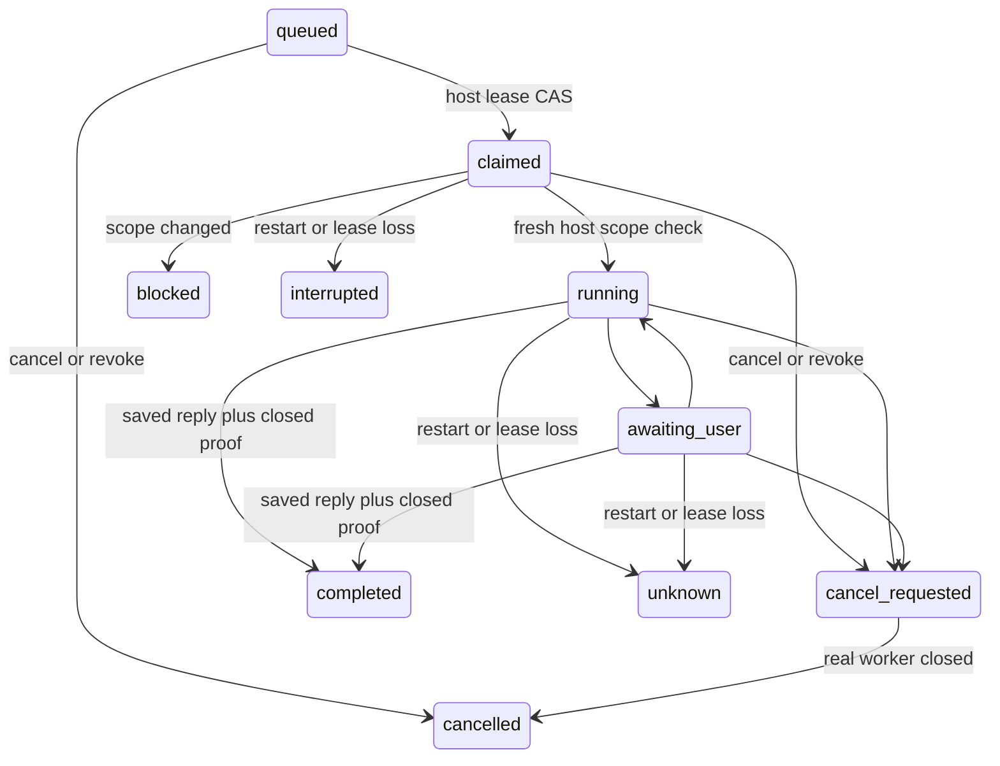

# 宿主持久任务队列

## 状态与范围

`desktop_pet/agents/job_queue.py` 是显式调用的 SQLite 引用账本。导入和构造不进行 IO，不创建后台线程，不启动模型或 worker。实际调度由 `desktop_pet/agents/coordinator.py` 完成，已接入已认证 `agent.send`、ChatController 原有保存/执行链和 AgentService 精确收束证明。手机提交到电脑后，可在电脑忙碌时收到持久排队确认，随后串行执行；手机尚未连接电脑时的本地待发不等于电脑已接纳。

当前采用保守重启边界：旧活动 worker 没有可独立核验的精确收束证明时，恢复为 unknown/interrupted 并阻止所有新电脑 Agent 派发，包括桌面自动路由；普通模型聊天仍可使用。已认证手机排队任务已接入精确绑定的 guardian 收束恢复，验证后只解除执行槽占用，不重放旧任务或伪造完成；旧版无绑定记录和直接桌面请求仍不具备该恢复能力。不会根据空进程列表或空内存注册表解除屏障。当前实现范围见 [远程 guardian](HOST_JOB_GUARDIAN_REMOTE_V1.md)，早期设计见 [coordinator 说明](HOST_JOB_COORDINATOR_PLAN.md)。

构造 `JobQueue(database_path, clock=...)` 后，宿主显式调用 `initialize()`。只能使用独立队列数据库，已有其他表的数据库会拒绝迁移。数据库不存在时，普通查询不会偷偷重建空账本。

## 只保存引用

每项只保存 job UUID、CID、generation、已保存用户消息 UUID、幂等请求 UUID、设置/权限 scope 的 SHA-256、固定状态/原因码、毫秒时间、lease token 的 SHA-256、已确认回复 UUID 和有限的 `artifact_<SHA-256>` 引用。没有 prompt、正文、路径、API Key、模型响应、raw 错误或明文 lease 字段。

v2 另存可选的 `origin_peer_id`，只能取自已认证 transport 的规范设备身份。相同幂等请求不得更换来源；dispatch 回调也必须明确返回同一来源。v1 的加列迁移保留状态、活动 lease 和未知 worker，不凭当前连接猜测旧任务的来源，也不自动重跑。

设备身份本身不能区分撤销后重新配对。`RemotePreferences.agent_authorization` 为每次配对保留宿主 nonce，重连与重命名不改变，撤销后重配会改变。只有真实已认证 admission 可以为旧版配对补存该值；普通读取不写配置。它只返回宿主身份栅栏 hash，nonce 不出现在公开设备列表中。coordinator 将其纳入 scope，并在派发及每次工具检查点确认前重新核验，旧排队授权不能因同设备重新配对而复活。

`HostJobReference` 只能由宿主用已提交的消息和当前权限快照构建。模型输出、远程消息附加字段或工具日志不能直接构建 scope/hash 或完成证明。设置 hash 不是原始设置，不能直接把密钥或任意文本塞入该字段。

同一幂等 UUID 与同 CID/generation/user_message_id 的重复 enqueue 始终返回原 job，包括终态。设置变化不会覆盖旧快照或创建新任务；dispatch 时会发现变化并阻止执行。幂等 key 跨会话或消息复用会报固定冲突；同一用户消息换新 key 也不能隐式创建重复任务。真正的新操作需要新的已保存用户消息和请求身份。

## 宿主调用顺序

1. 先提交真实用户消息，再 `enqueue(HostJobReference(...))`。
2. `claim()` 以 `BEGIN IMMEDIATE` 竞争串行执行槽，CAS queued→claimed，返回 `ClaimedJob(job, lease)`。明文随机 token 只在 `JobLease` 中交给宿主，不进数据库或公开快照。
3. **claim 不等于可执行。**宿主调用 `begin_dispatch(lease, revalidate=...)`，回调必须重新读取实际 CID/generation、用户消息是否仍有效、当前 settings/permission scope，以及执行权限。
4. 回调返回 `HostDispatchScope`。不符则提交 blocked，返回 `DispatchDecision(accepted=False, ...)`；只有 accepted=true 才能启动真实 worker。
5. 运行时用同一 lease heartbeat；首次提交给 worker 和每次工具检查点确认前也以该精确 lease 校验/续期，已过期 token 不能因尚未扫描而继续操作。等待提问可 running↔awaiting_user，但这不赋予新的权限，也不解除当前任务对执行槽的占用。
6. 真正收束后，失败/超时/取消通过 `host_acknowledge_stopped(..., worker_stopped=True)` 确认。completed 走单独的宿主归档 reconciliation，不能靠一个字符串状态直接写入。

最简状态关系：

## 租约与时间

clock 返回 UTC Unix 秒，持久化为毫秒；测试可注入时钟，不靠 sleep 模拟任务时间。claim、heartbeat、dispatch 和关闭确认都在获得数据库写事务后读取时间。dispatch 与完成 verifier 返回后再次读取时间和校验活动 lease，不能在回调耗尽租约后继续启动或写 completed。

FIFO 使用数据库插入 rowid，避免同毫秒或系统时间回拨时因随机 UUID 排序而派错顺序。默认 lease 30 秒，可选 1～300 秒；这是宿主所有权 lease，不是用户 Agent 步数/任务总时限。

过期 token、其他 token 和已清空的 token 都不能写状态或结果。没有“归还 queued”“重试终态”“复活旧 lease”的 API。

## 取消、清空与崩溃

queued 尚未发给 worker，可直接取消。`cancel_queued(cid)` 单个 SQL 事务取消该 CID 的全部等待项，不按历史分页猜测完成。claimed/running/awaiting_user 的取消只进入 `cancel_requested`，没有假装真实 worker 已经停止。远程 Stop 同时请求停止该 CID 当前可取消项并取消其等待项；已经进入归档提交的活动项不能谎报已停止。停止按钮、lease 超时或 UI 关闭本身都不是 worker 收束证明。

`revoke_conversation(cid, generation=old_generation)` 只撤销该代；不传 generation 则撤销整个 CID，包括未来 generation。queued 取消；活动项标 cancel_requested。被撤销代不能新增任务或写 completed。旧幂等请求仍返回原始终态，不会因历史清空而复发旧操作。

宿主在持有应用单实例锁的启动恢复阶段显式调用 `recover_after_restart()`。不要把打开另一个账本实例当作一次程序重启。claimed 保守进入 interrupted；已派发的 running/awaiting_user/cancel_requested 进入 unknown，清除 lease，绝不自动重放。

`recover_expired()` 和 claim 前的过期扫描做相同处理。**未知/中断任务的 worker_closed_at 未确认时仍占执行槽。**下一项不能因为旧 lease 消失就与仍可能操作电脑的旧 worker 并行。宿主独立确认该精确 worker 已关闭后，通过 `reconcile_worker_stopped(..., verifier=...)` 解除占用；原状态仍保留 unknown/interrupted，不伪造成功。

## 完成必须由宿主核验归档

`reconcile_completed(job_id, reply_id, verifier=..., lease=...)` 的 verifier 必须实际核对归档中已提交、完整、属于该 job/CID/generation/user_message_id 的回复，并确认真实 worker 已收束，返回 `SavedReplyProof`。同一用户消息的手机普通聊天、部分回复、工具日志或模型声称“完成”都不能代替该证明。artifact 引用也必须由宿主先核对归属和验证状态。

活动项必须提供当前有效 lease。恢复为 unknown/interrupted 后，不允许拿旧 lease 写结果；只有不携带旧 lease 的独立宿主 reconciliation 可以依据已保存的真实完整回复补记 completed。这个动作只修复账本，不再次运行任务。completed 的同一回复重复确认是幂等的，不能换回复或自动重启。

## 实际集成的锁顺序

队列事务只保证本数据库内的 CAS 和串行性，不能把另一个设置库、聊天库和真实进程启动变成一个跨库事务。

- host revalidate/stop/reply verifier 应短小、只读，不等待 UI/模型/worker，不重新调用本队列，避免重入写锁；
- 宿主以统一 dispatch/revoke 锁覆盖“读取新 scope→账本确认→最终 LF 提交”，并在每次持久工具检查点 ACK 前使用同一锁重新检查；完整输入的预写、SDK 启动及模型等待均不持锁；
- 先提交归档完整回复，再做 queue reconciliation，避免持有聊天库写事务时倒向获取 queue 写锁；
- 所有 UI/远程取消都只能调用 request_cancel/revoke，不能伪造 WorkerStoppedProof 或 SavedReplyProof；
- 真实进程的停止、旧 worker orphan recovery、消息归档和 artifact 验证仍由宿主完成。

## 验证层次

`python -m unittest tests.test_agent_job_queue -v` 使用独立临时数据库和 fake 时钟验证账本 CAS、FIFO、取消/dispatch race、scope/generation、lease、重启、归档证明、幂等和无内容存储；这组本身不启动 worker。

`tests.test_remote_agent_queue` 另外经过实际已认证 RPC、ChatController、SQLite 账本和隔离 SDK worker，使用本地 HTTP 合成 planner/独立 judge，验证忙时持久 ACK、跨任务串行上下文、手机新 CID、持久墓碑、撤销重配、清空代次、Stop、partial 和全局 startup unknown 屏障。`tests.test_host_queue_review` 为独立宿主审阅，另含实际 SDK 的同 CID steer/跨 CID 排队取消交接；`tests.test_staged_input_review` 验证真实管道的无 LF/EOF、写入取消与精确关闭。

这些是本机控制链回归，不代表真实模型任务成功率，也不代表已完成 Android 原生端到端验收。真实模型 benchmark 保留其各次原始成功/失败结果，不能用合成 fixture 替代。
