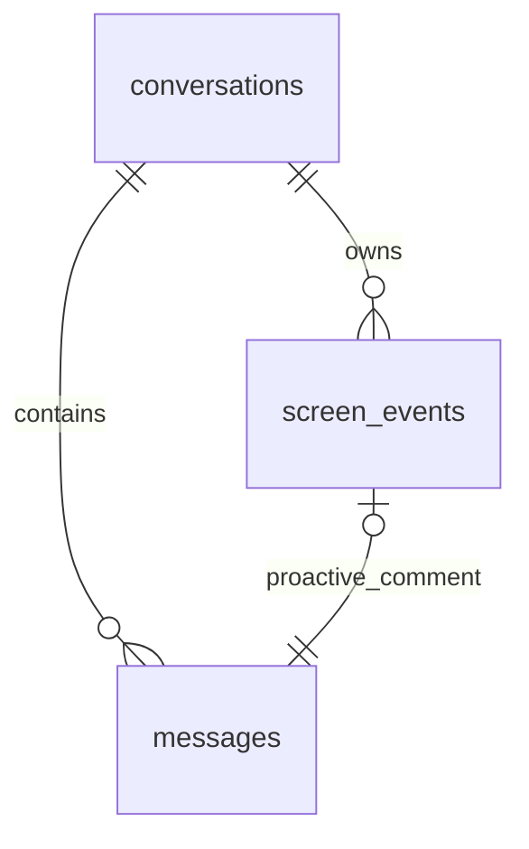

# 独立会话、屏幕事件与 Mem0 长期记忆（R7 / R8）

当前适用于 `2026.10.30-r8`，面板右上角显示“日常体验版 R8”。会话、数据库和 Mem0 基础设计由 R7 引入；R8 增加日常界面、本地 ONNX 检索、纯本地记忆管理、导出和诊断。没有重新制作角色资源、调整本轮角色动画或引入 Live2D。

最新完成的 R8 完整回归快照为 **565 项通过，227.156 秒，零失败、零跳过**，见 `artifacts/r8_daily_unittest_report.json`。后面的 R7 验证表保留历史标签，不作为 R8 新功能通过证据。正在开发的运行时自动记忆暂停另行验收，当前没有计入已完成清单。

R6 及更早文档中“聊天只在内存”“退出丢弃聊天”“屏幕评论不进入聊天”“没有长期记忆”的描述属于旧版本。本版将实际对话持久化到 SQLite，将会话概况单独管理，并通过可选的 Mem0 开源 SDK 保存少量长期记忆。

## 安装与启动

在仓库目录执行 Windows PowerShell 命令。已有 `.venv` 时跳过第一行。

```powershell
py -3.10 -m venv .venv
.\.venv\Scripts\python.exe -m pip install -r requirements.txt

# 需要长期记忆时安装；普通桌宠、会话历史和聊天不依赖这一组可选包
.\.venv\Scripts\python.exe -m pip install -r requirements-memory.txt
# 可选：改用 CPU 本地 Embedding；本文件已包含上面的 Mem0 依赖
.\.venv\Scripts\python.exe -m pip install -r requirements-memory-local.txt
.\.venv\Scripts\python.exe -m pip check
.\.venv\Scripts\python.exe main.py --debug-panel
```

也可以双击 `start_pet.bat`，再通过角色右键或托盘打开窗口。无需单独启动数据库服务。记忆使用本机磁盘模式 Qdrant，不要求 Docker、Qdrant 服务端或 Mem0 托管账号。提炼仍使用所选语言模型 API；远程 Embedding 使用独立服务，本地 FastEmbed 则在下载后仅使用 CPU 和缓存。使用本地向量并不表示整套事实提炼完全离线。

同一配置文件只允许一个桌宠进程：再次普通启动会打开原实例的聊天窗口，带 `--debug-panel` 会打开原调试面板，不新建会话或第二个 Mem0 所有者。原实例无法及时回应时明确报错。锁与固定命令本地通信的边界、后续验证记录见 [R7 后续修复](R7_FOLLOWUP.md)。

可选依赖固定为 `mem0ai==2.2.1`、`qdrant-client==1.20.0`。实现对照了 [Mem0 Python Quickstart](https://docs.mem0.ai/open-source/python-quickstart)、[OSS 配置文档](https://docs.mem0.ai/open-source/configuration)及安装版本的真实签名。本项目调用 `Memory.from_config`、`add(..., user_id=..., infer=True)`、`search(..., filters={"user_id": ...}, top_k=...)`、`get_all`、`get`、`delete`、`delete_all(user_id=...)` 和 `close`；不依赖托管版 `MemoryClient`。

本地模式另固定 `fastembed==0.9.1`、`onnxruntime==1.23.2`，不需要 Torch。实现核对了 [Mem0 FastEmbed 配置](https://docs.mem0.ai/components/embedders/models/fastembed)与 [Qdrant 离线模型选项](https://qdrant.tech/documentation/edge/edge-fastembed-embeddings/)，只补充已安装 SDK 原生适配器缺少的缓存、线程和离线控制，提炼与检索仍由真实 Mem0 完成。

## 三类数据分别保存

| 数据 | 保存位置 | 用途与边界 |
| --- | --- | --- |
| 实际对话 | SQLite `messages` | 保存用户消息、正常回复、被决策选为发言的屏幕评论；历史查看保持完整，不等于每次全量发送模型。 |
| 会话标题与概况 | SQLite `conversations` | 标题用于历史列表，概况用于当前会话压缩上下文；每个会话独立，概况不是跨会话记忆。 |
| 长期记忆 | Mem0 + 本地 Qdrant + SDK 历史库 | 经筛选的用户稳定事实、偏好、确认计划及项目进展；不整批保存聊天，不自动记住浏览画面。 |



普通消息的 `role` 是 `user` 或 `assistant`，`source` 分别是 `user`、`assistant`。屏幕评论也是 `assistant`，其 `source=proactive_screen`，通过明确的 `screen_event_id` 关联事件。Mem0 记录带稳定用户标识，并可保存来源 `conversation_id` 元数据；它不通过聊天库外键管理，不会因为删除会话而被级联删除。

## 会话的使用方法

右键角色选择“打开聊天窗口”，或进入调试面板“聊天测试”。两个视图使用同一个当前活动会话。

- 左侧“新建对话”创建新的 UUID 和空上下文。每次启动应用也默认进入新的空上下文，不自动续接上次记录。首次有效消息或屏幕评论到来时才创建数据库记录，空会话不堆积到历史列表。
- 历史按最近更新时间排列，列表只显示单行标题，悬停查看完整标题。点击历史项后，上方标题显示当前会话；接下来发送的消息保存到这一历史会话。
- “搜索标题和消息”按标题和实际消息文本搜索。“重命名”设置手工标题，后续自动生成不会覆盖它。“删除”会二次确认，然后删除该会话、消息和关联屏幕事件。
- “历史”按钮可收起侧栏；输入框 Enter 发送，Shift+Enter 换行。失败显示错误并提供“重试”，不会因为重试再插入同一条用户消息。
- “清空对话”确认后仅清除当前会话的消息、事件和概况，不清空其他会话或 Mem0。关闭聊天窗口、调试面板或记忆窗口只隐藏窗口，不退出桌宠。
- “工具 → 聊天服务设置”直接打开现有控制台 API 页；“长期记忆”和“上下文预算”也在同一工具菜单。会话草稿和阅读位置分别保留，请求阶段会显示实际保存、检索、生成、保存过程。

消息写入即提交数据库，不等到退出才保存。数据库读取、写入、标题/概况生成、聊天和记忆请求放在工作任务中。异步回复携带最初的会话 ID；切换会话后，迟到回复保存到它原本所属的会话，不覆盖当前视图。加载旧会话失败会显示错误并恢复原视图，不偷偷创建替代记录。

### 自动标题和概况

会话先使用第一条有效消息或屏幕摘要作为本地标题。后台只向模型发送少量早期消息，同时生成具体标题和首个简短概况；概况用于当前会话上下文，不展示在历史列表。标题成功后固定，失败使用本地标题和标明“本地消息摘录”的概况，不影响聊天。

长对话保留最近 16 条原始消息作为默认候选上下文；更早资料每累积 8 条后进行一次增量概况更新。更新只发送已有简短概况和这批较早消息的有限摘录，不重复发送整段档案。失败时使用标明“本地消息摘录（非模型总结）”的回退，并保留数据库中的完整原文。标题生成状态、手工标题标记、概况及摘要覆盖游标一起持久化。

后台标题/概况写入会核验用于生成的消息仍属于该会话；如果用户已经清空消息，晚到元数据不会恢复被清空的概况，也不会用旧内容覆盖之后的新聊天。

### 显式导出当前会话

“工具 → 导出当前对话”允许保存 Markdown / JSON。导出对象在打开文件选择框前捕获明确会话 ID，读取完整归档，不使用当前界面的截断视图或模型近期上下文。

导出在后台使用 SQLite 只读事务取得一致快照，白名单包含会话元数据、完整消息和相关屏幕文字情境；不读取 API 设置、系统凭据、内部 JSON metadata 或截图。内联图片数据会被排除，Markdown 的动态 HTML 与图片语法做安全处理。事件关系不完整的旧坏记录会明确拒绝导出。

先写同目录临时文件并刷新，再原子替换目标；正常写入失败保留已有文件并清理临时文件，拒绝把源数据库本体作为目标。取消文件选择不创建文件，自动补全后会覆盖另一已有文件时再次确认。导出期间切换会话不会重新定向正在导出的对象。导出副本可能含有用户主动说过的私人文字，应由用户明确保存与分享。

## 从屏幕评论进入连续对话

沿用“屏幕感知”现有的本地观察、独立远程授权、隐私过滤、去重、冷却和配额。普通聊天不会自动附带屏幕截图。

1. 开启并保存本地观察及远程分析；取得安全预览后，可使用“评论当前画面”，也可等待自动评论。
2. 一次真实发言决定使用发起分析时明确捕获的会话 ID。事件和正式助手消息在同一事务中保存；保存成功后才显示可以点击的评论气泡。未打开聊天窗口时同样保存。
3. 点击这条气泡，打开对应会话并定位到这条消息，显示关联的应用、事件时间、类型和文字情境摘要。普通动作反馈气泡仍保持鼠标穿透；关联评论气泡接受点击以打开对话，不抢键盘焦点。
4. 在聊天中追问“刚才那个报错怎么修复？”时，请求会结合当前会话的近期消息、相关事件摘要、当前概况和少量相关长期记忆。
5. 气泡消失后仍可从历史中打开该会话，找到“鲸鱼娘 · 来自屏幕感知”消息，点击“查看情境”。

事件默认只保存必要应用进程名、时间、简短文字摘要、事件类型和元数据；不持久化截图，也不存整段观察过程。安静、只动作和未被决策选为发言的候选评论属于感知面板的短期调试数据，不会被无差别保存成聊天消息。已决定发言并成功归档后，若新的用户操作优先而抑制气泡，正式消息仍保留，用户可以在历史查看。新会话不自动复制旧消息、概况或屏幕事件。

## Mem0 配置与用户控制

长期记忆现在采用程序管理配置。用户从聊天左下角「设置 → 长期记忆」进入，只需操作「自动记忆」开关和管理已保存的内容；模型、Embedding、密钥、维度和 Token 参数不再展示为用户表单。

1. 在「模型与 API」保存普通聊天服务，确保可以正常聊天。
2. 开启「自动记忆」。对于尚未配置或绑定记忆库的新用户，程序选择本地中文 FastEmbed `BAAI/bge-small-zh-v1.5`、复用已保存的聊天配置，并在后台准备模型。
3. 准备失败会显示简短说明，可点击「重新准备」重试。没有准备好时，普通聊天、查看和删除已有记忆仍可使用。仅打开页面或启动应用不会触发模型下载或连接测试。
4. 关闭「自动记忆」会立即暂停正在进行的自动提炼，并在后台保存关闭状态；已有记忆仍可检索，不会删除内容。保存失败会明确提示，不把临时暂停误报为已经保存。
5. 搜索只筛选本地记录。选择一条后才显示详情、来源、更正历史、修改和删除；清空需二次确认，删除会调用真实 Mem0 接口。

新用户使用本地检索不需要单独的 Embedding 密钥；记忆提炼仍会向已配置的聊天服务发送筛选后的用户陈述并产生 API 用量。聊天模型不可用、未安装可选依赖或记忆操作失败时，聊天记录仍保留。可选运行依赖由项目安装阶段提供：`requirements-memory-local.txt`。

已有向量库、Embedding 身份或自定义模型与凭据的配置保持兼容，不会为套用推荐默认值而自动更换模型、清空或重建数据。遇到旧服务不可用时显示错误，不会暗中转发到别的服务。低层配置接口仍为开发和兼容保留，不在普通设置页提供技术表单。

默认本地缓存为 `%USERPROFILE%\.cache\aura-desktop-agent\fastembed`。模型准备有 120 秒期限；正式本地检索仅使用缓存、CPU 和离线加载，管理记录不下载模型。默认检索相关度 0.60、最多检索 4 条，聊天上下文还受统一预算约束。

用户标识固定保存，不能从页面修改。密钥仍使用系统凭据，复用聊天服务不会复制密钥到记忆设置文件。记忆内容来自用户明确表达的偏好、事实、计划和进度；助手文字、画面观察、网页观点、猜测及凭据不作为自动记忆候选。

完整聊天、会话概况和长期记忆分别保存。删除会话不删除记忆；清空记忆仅处理当前用户可归属的数据，保留其他用户、无关集合及无法可靠归属的旧历史。现有向量空间的身份保护与编辑并发检查继续生效。

## 本地路径、数据库和迁移

以 `SettingsManager.config_path` 的父目录为数据根目录。Windows 通常为 `%LOCALAPPDATA%\AURA Desktop Pet`，实际位置由 Qt 当前用户的 `AppConfigLocation` 决定。

```text
<数据根目录>/
  settings.ini                 非密钥配置、角色/感知参数与上下文预算
  conversations.sqlite3        完整对话、会话元数据、屏幕文字事件
  conversations.sqlite3-wal    SQLite 运行期间的 WAL 文件
  conversations.sqlite3-shm    SQLite 运行期间的共享内存文件
  memory/
    memory_settings.json       非密钥 Mem0 参数及稳定用户 UUID
    embedding_identity.json    已写入向量库使用的 Embedding 标识
    qdrant/                    Mem0 本地向量库和实体存储
    mem0_history.sqlite3       Mem0 SDK 自己的历史/候选记录
    runtime/                   Mem0 运行目录
```

公开 ONNX 权重缓存独立放在 `%USERPROFILE%\.cache\aura-desktop-agent\fastembed`，不属于聊天数据库，也不包含用户事实。导出文件只在用户明确选择的位置生成。

`conversations` 包含 ID、标题、概况、创建/更新时间、状态、消息数量、自动/手工标题标记及概况游标。`messages` 包含 ID、会话 ID、role、content、created_at、source、screen_event_id 和 JSON metadata。`screen_events` 包含 ID、会话 ID、observed_at、app_name、context_summary、event_type 和 metadata。

数据库启用外键、WAL 和繁忙超时，每次操作使用自己的连接与事务；会话删除级联处理消息和事件。`messages(screen_event_id, conversation_id)` 通过复合外键指向同一会话的事件，唯一索引保证一条事件对应一条主动评论，CHECK 约束限制角色与来源组合。会话更新时间、消息/事件查询均有索引。屏幕事件与对应消息在同一事务中写入，失败整体回滚。

迁移使用 `PRAGMA user_version`，当前版本为 **2**。首次初始化创建 v1 三表与约束，v2 增加标题标记、摘要游标、消息计数及维护计数的触发器；已有记录不覆盖、不删除。数据库版本比程序更新时拒绝打开并提示升级。R6 以前没有持久聊天库，因此旧进程退出后丢弃的历史无法恢复。

SQLite 聊天和 Mem0 本地数据并非加密档案，使用当前 Windows 账户的文件权限保护。备份时先正常退出桌宠，再复制数据目录，保留原配置与用户 UUID；API Key 位于系统凭据库，不在备份文件中。仓库 `.gitignore` 排除数据库、日志、运行时数据、导出及本地记忆目录；不要手工将聊天库或个人记忆加入 Git。

## 有限上下文与预算

完整历史只用于归档和按需查看。正常回复、标题和概况生成使用统一预算组装器；当前会话以外的原始消息和概况不会进入请求。

| 默认分配 | Token 估算预算 |
| --- | --- |
| 输入 + 输出总量 | 8192 |
| 输出预留 | 1024 |
| 系统角色提示 | 768 |
| 当前会话概况 | 1024 |
| 近期消息 | 4096，最多 16 条 |
| 相关屏幕事件 | 512，最多 3 条 |
| 相关长期记忆 | 512，最多 3 条 |

各项为上限而非必须用完的配额。没有服务商 tokenizer 时，按 UTF-8 字节数再加 10% 余量和消息封装开销做保守估算；界面显示的是估算值，不能当成服务商实际计费 Token。不同语言、模型和 tokenizer 的真实值可能不同。

先保留系统设定和完整当前问题，给输出留预算；再限量加入相关事件、概况、记忆和近期整条消息。较旧、超额资料让位，不通过无限累积消息来扩大请求。当前问题不会被静默截断；单条输入超过 8000 字符或完整问题无法放入总预算时明确拒绝，用户可缩短或调整预算。

聊天“工具 → 上下文预算”允许修改总预算和输出预留，保存后持久化，下次请求生效。分类预算和近期消息数量的默认值在 `desktop_pet/conversations/context.py` 的 `ContextBudget` 中集中定义，支持通过配置管理加载。界面提供本轮估算输入、输出预留及裁剪情况，可与完整历史的消息数对照检查。

### Mem0 提炼使用独立预算

上述 8192 是正常聊天默认预算，不能套用到 Mem0 SDK 的内部事实提炼提示。`mem0ai 2.2.1` 自带较大的提炼提示和工具定义，即使只输入一条短事实，也可能超过 8192 的保守估算。因此“长期记忆 → 配置与隐私”独立提供“Mem0 提炼总 Token 预算” `extraction_context_tokens`（默认 65536，可设 4096～262144）和“Mem0 提炼输出预留” `extraction_output_tokens`（默认 1024，可设 32～1024）。提炼总量包含输入和输出预留，调整记忆预算不改变聊天预算。

每次真正发送提炼模型请求前，程序会检查 SDK 展开后的完整消息、历史和工具定义。超过记忆专用预算时明确报错并拒绝发送该次提炼模型请求，不偷偷扩大预算，也不把空提炼结果冒充成功。请根据记忆提炼模型的真实上下文能力设置：若模型本身不支持 SDK 所需的大提示，应换用合适的独立记忆模型，普通聊天仍可继续。较大的上限不表示每次都会用满，实际成本仍由所配置服务商按实际请求计算。

Mem0 在生成提炼提示前可能先检索已有记忆并调用 Embedding，因此“预算拒绝”保证未发送的是**提炼模型请求**，不保证此前没有任何 Embedding 网络请求。较长候选或较多已有记忆也可能超过默认 65536，此时会明确报错，已保存聊天保留并继续使用普通会话上下文。

## 可执行验收步骤

### 会话与屏幕评论

1. 启动桌宠，打开聊天，发送一条有特征的消息并等回复。记下标题，关闭窗口再打开，消息仍在。
2. 点击“新建对话”，确认空白上下文且标题变化；不要发送即退出，重启后空对话不应堆积在历史列表。
3. 重启后默认新对话，从历史点击步骤 1 的会话，确认原消息完整；手工重命名并重启确认标题保留。
4. 取得安全屏幕预览并“评论当前画面”。待实际评论出现，点击气泡，确认打开对应会话和“关联屏幕情境”。追问“刚才那个页面有什么值得注意的？”；在历史中也应看到“来自屏幕感知”和“查看情境”。
5. 新建另一个会话，确认没有复制步骤 4 的消息和事件。删除该会话需确认，其他会话和 Mem0 仍保留。

### 跨重启长期记忆

1. 安装可选依赖，配置实际可用的提炼与 Embedding 服务，启用记忆和自动提炼。
2. 在会话 A 中明确发送“记住，我长期偏好大字体评论气泡。”，等回复及后台提炼。打开“长期记忆”刷新，确认具体记忆真实存在；模型没有形成记忆时按错误提示排查，不把普通聊天回复当作已保存证据。
3. 正常退出整个桌宠，再启动。默认进入新的会话 B，询问“我偏好的评论气泡字体是什么？”。确认旧会话原始记录没有自动加载，但相关事实能经 Mem0 检索用于回答。也可在记忆页搜索“字体”确认重启后仍能找到。
4. 对不相关的问题检查本次请求不应混入大量“字体”记忆。暂停自动提炼后发送另一偏好，确认不会自动新增，但已有记忆仍可检索。
5. 删除这条记忆再搜索，确认不存在；删除聊天会话不应顺带删除其他记忆。清空长期记忆后二次确认，再刷新确认实际为空。

### 上下文和降级

1. 在同一会话连续对话超过 24 条消息，等待后台概况更新；历史仍可完整查看，侧栏及其悬停提示仍只显示标题。
2. 检查聊天页的估算输入一直受设置预算限制，消息数增加不代表请求持续增长。把总预算适当调低，确认会裁剪较旧资料，仍保留当前问题；超大的单条问题应得到明确错误。
3. 在回复未完成时切到另一个会话，迟到回复应只进入原会话。再打开原会话确认完整记录。
4. 在记忆页删除 Embedding 密钥或配置不可达服务，确认记忆报错但正常聊天和会话历史仍可使用；已提交的消息不丢失。

### 自动测试与证据边界

```powershell
.\.venv\Scripts\python.exe -m compileall -q main.py desktop_pet tests
.\.venv\Scripts\python.exe -m pip check
.\.venv\Scripts\python.exe -m unittest tests.test_conversation_store tests.test_context_budget tests.test_chat_controller tests.test_memory_service tests.test_memory_controller tests.test_session_ui -v
.\.venv\Scripts\python.exe -m unittest discover -v
# R8 合成窗口/纯离线模型检查，不截图用户桌面
.\.venv\Scripts\python.exe -m tests.experience_smoke
.\.venv\Scripts\python.exe -m tests.local_embedding_smoke
# 标准库起步的只读诊断，不检查连接或模型
.\.venv\Scripts\python.exe -m desktop_pet.diagnostics --json
```

新增测试覆盖 SQLite 事务与迁移、会话隔离/重启/删除、屏幕评论关联、迟到回复归属、标题与增量概况、预算不增长及 UI 操作。`test_memory_service.py` 使用真实 Mem0 SDK 和本地 Qdrant，只将模型与 Embedding 服务替换为确定性的 localhost HTTP：验证真实提炼、重开存储后检索、相关度、删除、清空、维度变更保护、超时和失败降级；它不是用内存列表冒充 Mem0。未安装可选 SDK 时，相关真实 SDK 测试会标记跳过，不可将跳过计为通过。

### R8 已完成的验证

| 检查 | 证据边界 |
| --- | --- |
| 日常功能完整回归 | **565 项通过，227.156 秒，零失败、零跳过**；`artifacts/r8_daily_unittest_report.json`。后续定向诊断 11 项、窗口/记忆 43 项通过，不与完整数相加。 |
| 第一批历史快照 | 514 项通过，172.719 秒；`artifacts/r8_experience_unittest_report.json`。不替代后续完整结果。 |
| 体验 smoke | 44 项检查通过；真实 Qt offscreen 合成窗口和临时配置，`artifacts/r8_experience_smoke.json`。 |
| 真正的本地向量 | ONNX 中文模型下载、512 维推理、Mem0 提炼/重建检索/删除/清空通过；提炼 LLM 为 localhost fixture，未调用远程 Embedding。 |
| 纯本地记忆管理 | 9 项覆盖共享实体、当前用户清理、其他 namespace/无关集合保留、缺密钥和离线请求阻断。 |
| 导出与诊断 | 9 项导出独立安全边界通过；11 项诊断测试及实际中文/JSON 命令通过。详情见 [本轮交付清单](CONTINUOUS_IMPROVEMENT.md)。 |
| 实际 R8 启动与空闲观察 | 仅枚举自身窗口确认桌宠/控制台可见；49.181 秒只读空闲采样，单逻辑核 CPU 2.41%，16 线程整机口径约 0.15%。未触发模型，不代表检索或提炼时性能；`artifacts/r8_live_startup_report.json`、`artifacts/r8_live_idle_performance.json`。 |

本轮没有实测原生通知区注册/物理点击、真实多屏热插拔、外部生产 LLM / 视觉 / Embedding，也没有修改角色建模或动画。下一批运行时自动记忆暂停仍在开发，不能算入上述已完成结果。合成窗口截图只验证渲染与交互代码，不能代替真实 Windows 原生行为。

### R7 历史验证记录

以下为 R7 首轮全套与实际运行验证。Mem0 和屏幕联动专项已包含于全套，不重复累加测试数量。记忆并发、单实例及原生验证隔离的后续结果单独见 [R7 后续修复](R7_FOLLOWUP.md)，下列 429 项不代表后续代码已重新执行。

| 检查 | 实际结果 |
| --- | --- |
| Python 语法与依赖 | `compileall`、`pip check` 通过；完整汇总为 `artifacts/r7_validation_summary.json` |
| R7 首轮全套自动化回归 | **429 项全部通过，158.250 秒，零跳过、零失败，退出码 0**；见 `artifacts/r7_unittest_report.json` |
| 调试面板 smoke | 29 项检查通过，见 `artifacts/panel_smoke_report.json` |
| 屏幕感知 smoke | 32 项检查通过，见 `artifacts/perception_smoke_report.json` |
| R7 屏幕评论、Qt 气泡定位与会话联动集成 | 当时 8 项通过（5.300 秒），新增清空/删除时取消旧分析、防止会话复活 |
| 真实 Mem0 SDK 专项 | 全套中的 18 项；独立运行 127.102 秒、无跳过，模型与 Embedding 使用 localhost 固定响应 |
| Windows 物理鼠标 smoke | 已尝试；环境调用 `SetCursorPos` 返回 `False`，未完成，不计为通过 |
| Windows 原生采集 smoke | 已尝试；无法将合成 probe 置于前台，未完成，不计为通过；未捕获用户桌面、没有网络请求 |
| R7 当时的真实聊天服务 | 实际 API 请求成功，获得非空文本；未修改配置/聊天记录/记忆开关，报告为 `artifacts/r7_external_chat_report.json`，未记录服务地址或密钥 |
| 生产 R7 启动与界面 | 实际启动并通过 UI Automation 选择聊天页、确认新建/历史搜索、打开和关闭长期记忆窗口后桌宠仍显示；既有设置哈希不变，未发 API 或截图，程序保留运行；`artifacts/r7_live_startup_report.json` |
| Windows Credential Manager | 真实临时独立凭据写入、跨实例读取、删除及清理通过，不改生产账户；`artifacts/r7_vault_report.json` |
| 安全和资源保持 | 95 份文件的已知密钥精确扫描 0 命中，本地数据忽略规则通过，原鲸鱼 PNG 与 HEAD 一致；`artifacts/r7_security_report.json` |

R7 完整文件清单和 25 条验收映射见 [R7 交付记录](R7_DELIVERY.md)。R2～R7 的通过数量只说明各自当时的功能，不代表 R8 新代码重新通过。localhost 模型固定输出只能证明集成与隔离流程，不能证明外部服务的提炼准确率或每种兼容服务商都可用；R7 当时的真实聊天调用也不代表 R8 本轮验证了外部模型、Embedding 或 Mem0 语义质量。

## 主要模块与当前限制

| 模块 | 职责 |
| --- | --- |
| `conversations/store.py` | 版本迁移、SQLite 事务、消息/事件与历史查询 |
| `conversations/context.py` | 上下文隔离、统一 Token 预算、裁剪与估算 |
| `conversations/export.py` | 指定会话的只读事务快照、白名单字段和原子导出 |
| `chat_controller.py` | 活动会话、异步聊天、历史操作、屏幕评论落库与迟到回复归属 |
| `conversation_metadata.py` | 一次性标题、增量概况及有标识的本地回退 |
| `async_tasks.py` | 可清理的 Qt 工作任务与完成通知 |
| `single_instance.py`、`app.py` | 按配置路径取得单实例锁，再次启动通过本地固定命令打开原实例界面 |
| `memory/settings.py`、`memory/service.py` | 非密钥配置、候选准入、凭据、Mem0 服务接口与期限 |
| `memory/worker.py` | 真正的 Mem0 SDK / 本地 Qdrant 操作与安全输出 |
| `memory/local_embedder.py`、`memory/semantic_qdrant.py` | 离线 CPU 模型、禁止隐式下载、namespace 与共享实体的本地管理 |
| `memory_controller.py`、`ui/memory_panel.py` | 异步管理和查看/搜索/暂停/删除/配置界面 |
| `ui/chat_panel.py` | 历史侧栏、消息及情境详情、重试、预算和记忆入口 |
| `tray.py`、`ui/window_state.py` | 托盘入口、运行时感知暂停和窗口恢复/边界 |
| `diagnostics.py` | 无凭据、无配置、无网络的本地依赖与 PNG 检查 |
| `perception/controller.py`、`bubble.py`、`application_controller.py` | 将保存成功的屏幕评论与可点击气泡关联到指定会话 |

记忆为保守筛选而非“所有事情都能记住”；提炼和检索的质量取决于用户配置的模型。SDK 在短生命周期隐藏子进程内运行，单次操作有包括排队等待的整体期限并串行保护本地存储，避免超时后占住 Qdrant；取得锁后复核最新记忆开关与自动提炼偏好。聊天界面仍可操作，记忆失败时按现有会话继续。标题与概况同样是模型生成或有标识的摘录，不能替代完整记录。

本版没有截图归档、语音、OCR、自动操作电脑、Live2D、跨设备同步、多用户账户切换或加密聊天库。没有授权时不开启屏幕外发；记忆的启用也不会改变屏幕感知授权。
